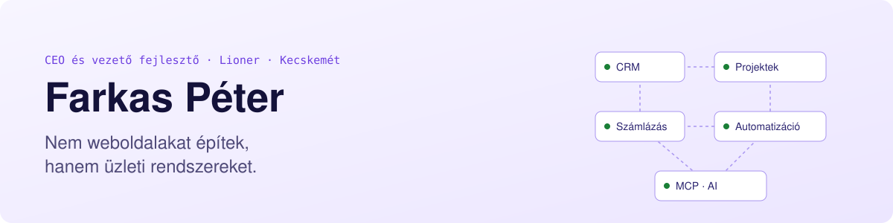
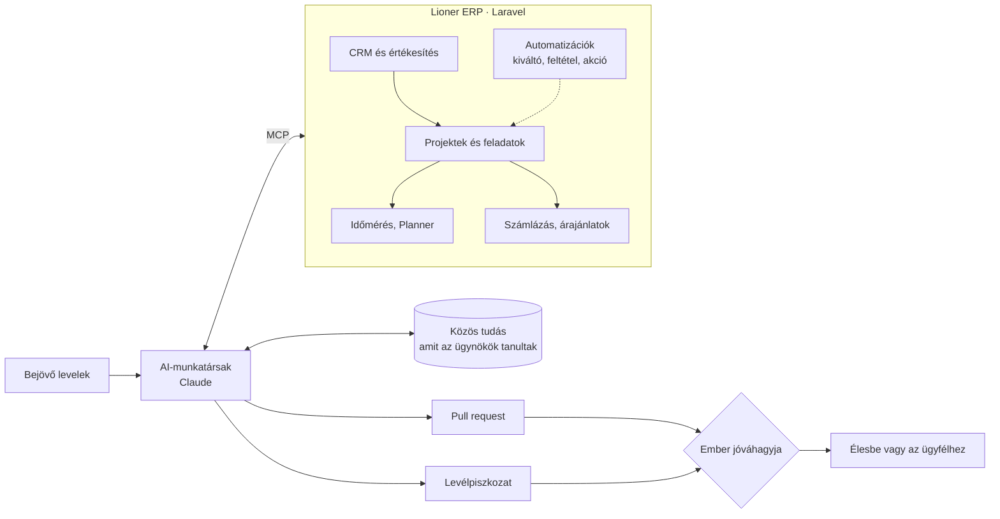

<picture>
  <source media="(prefers-color-scheme: dark)" srcset="assets/banner-dark.svg">
  
</picture>

### Szia, Péter vagyok

A [Lioner](https://lioner.hu) egyik alapítója. Kristóffal ([@adamkristoflioner](https://github.com/adamkristoflioner)) ketten visszük a céget Kecskeméten, én a fejlesztésekért felelek, és a projektek nagy része is nálam fut össze.

14 évesen kezdtem, egy játékszerver közösségének raktam össze oldalt. Most főleg olyan rendszereket építünk Laravelben, amikre egy cég napi működése épül: ERP, CRM, összetett webshopok, belső eszközök. Nekem az a jó projekt, ami nem az átadáskor ér véget, hanem évekig fut, és közben nő a céggel együtt.

> A jó szoftver nem attól jó, hogy elkészül, hanem attól, hogy évek múlva is működik.

🦁 [lioner.hu](https://lioner.hu) · ✍️ [Blog](https://lioner.hu/blog/szerzo/farkas-peter) · 💼 [LinkedIn](https://www.linkedin.com/in/farkasp%C3%A9ter/) · 👤 [Bemutatkozás](https://lioner.hu/rolunk/farkas-peter)

### Rendszerek, amiket életben tartunk

| | Rendszer | Mi ez | Mióta |
| :---: | --- | --- | --- |
| 🟢 | **TrustPhone** | Webshopnak indult, mára 20+ felhasználós ERP és CRM lett belőle: készlet, felvásárlás, szerviz és értékesítés egy helyen. Saját MCP-szerverén keresztül Claude-ból is lehet tőle kérdezni, például hogy melyik telefont mennyiért érdemes felvásárolni. | 2021 óta |
| 🟢 | **Lioner ERP** | A saját rendszerünk, ezen fut az egész cég: CRM, projektek, időmérés, számlázás, árajánlatok, automatizációk. Három AI-munkatárs is ebben dolgozik velünk. | napi használatban |
| 🟢 | **PremioWebshop** | Egy hőszigetelés-gyártó B2B és B2C webáruháza. Négy korábbi oldaluk volt, ezekből lett egy. | élesben |
| 🟢 | **[CityFox](https://cityfox.hu)** | Telefonon játszható városi kalandjáték, saját valós idejű játékmotorral. CityRoom néven 1. helyet ért az MVM Edison 2022-n. | élesben |
| 🟢 | **Átvett projektek** | Félbemaradt vagy gazdátlanná vált rendszerek, amiket átvettünk, rendbe tettünk, és azóta mi visszük tovább. Erről [itt írtam](https://lioner.hu/blog/eltunt-a-webfejlesztod-mit-csinalj) bővebben. | folyamatosan |
| ⚪ | **RUNaway** | QR-kódos nevezési rendszer futóversenyekhez. | 2020-2021, lezárva |

A többi közös munkánk Kristóffal: [lioner.hu/referenciak](https://lioner.hu/referenciak)

### Így áll össze a Lioner ERP

Ez az a rendszer, amin a napjaink nagy része telik. Az AI-munkatársak MCP-szervereken keresztül ugyanazokat az adatokat látják, mint mi, de ami az ügyfélhez kimegy vagy élesbe kerül, azt mindig valaki közülünk hagyja jóvá.



A közös tudás a kedvencem: ha egy ügynök rájön valamire (egy hiba gyökerére, egy csapdára), felírja, és a következő futásnál a többiek is látják. A gépemen futó Claude Code is ebből dolgozik, úgyhogy amit egyszer kiderítettünk, azt nem kell kétszer.

### Mire szoktak hívni

- Egyedi ERP vagy CRM, ha egy cég kinőtte az Excelt, és a dobozos szoftverek sem illenek rá
- Webshop, ami több egy kosárnál: B2B és B2C egyben, integrációkkal (SimplePay, Billingo, GLS)
- Valós idejű dolgok Socket.io-val, a játékmotortól az élő admin felületekig
- Chatbot a cég belső dokumentumaira, termékajánló motor webshopba
- Projekt átvétele, ha eltűnt a fejlesztő: megnézzük, menthető-e, és ha igen, rendbe tesszük

### Amivel dolgozom

| Terület | Eszközök |
| --- | --- |
| Backend |     |
| Frontend |    |
| Valós idő |  |
| Adat és üzemeltetés |    |
| AI |   |

### Rendszerállapot

<picture>
  <source media="(prefers-color-scheme: dark)" srcset="https://raw.githubusercontent.com/dubstal99/dubstal99/output/status-dark.svg">
  
</picture>

Nyilvános repóm kevés, mert szinte minden ügyfélrendszer, amin dolgozom, privát. A fenti kártya és a lenti zöld grafikon viszont a privát munkát is mutatja, csak név nélkül.

### Írásaim

A Lioner blogjára írok, főleg arról, amibe az ügyfeleink belefutnak: mikor kell Excel helyett rendszer, mire figyelj fejlesztőválasztásnál, mit lehet kezdeni egy félbemaradt projekttel.

<!-- BLOG:START -->
- [Claude Dashboard lépésről lépésre: élő kimutatás a céges adataidból](https://lioner.hu/blog/claude-dashboard-beallitasa) · 2026. október 15.
- [Munkaidő-nyilvántartás: mikor kell Excel helyett rendszer?](https://lioner.hu/blog/munkaido-nyilvantartas-excel-helyett-rendszer) · 2026. október 12.
- [B2B webshop: miben más, mint egy hagyományos webáruház?](https://lioner.hu/blog/b2b-webshop-miben-mas) · 2026. október 9.
- [Hogyan válassz webfejlesztőt? 11 szempont, amit ajánlatkérés előtt ellenőrizz](https://lioner.hu/blog/hogyan-valassz-webfejlesztot) · 2026. szeptember 21.
- [5 SEO tipp, hogy a cikkeid Google-ben és ChatGPT-ben is jobban teljesítsenek](https://lioner.hu/blog/5-seo-tipp-hogy-jobbak-legyenek-a-cikkeid-google-ben-es-chatgpt-ben) · 2026. szeptember 20.
<!-- BLOG:END -->

Az összes cikkem: [lioner.hu/blog/szerzo/farkas-peter](https://lioner.hu/blog/szerzo/farkas-peter)

### Changelog

<details>
<summary>Hogyan jutottam ide, verziószámokkal</summary>

```md
## [5.0.0] 2026
### Hozzáadva
- AI-munkatársak a saját ERP-nkben, MCP-szervereken keresztül
- közös tudásbázis, amibe az ügynökök visszaírják, mit tanultak

## [4.0.0] 2025
### Eltávolítva
- home office
### Hozzáadva
- saját iroda Kecskeméten

## [3.0.0] 2023
### Változott
- a harmadik alapítótárs kilépett, azóta Kristóffal ketten visszük főállásban

## [2.1.0] 2022
### Hozzáadva
- MVM Edison, érett fázis kategória: 1. hely a CityRoommal (ma CityFox)

## [2.0.0] 2021
### Hozzáadva
- Kristóffal megalapítjuk a Lionert
- elindul a TrustPhone, azóta is fejlesztjük

## [1.1.0] 2020
### Hozzáadva
- RUNaway: QR-kódos nevezési rendszer futóversenyekhez

## [1.0.0] 2019
### Hozzáadva
- szoftverfejlesztő végzettség a kecskeméti Kandóban, itt ismertem meg Kristófot
- utána autodidakta módon és képzéseken tanultam tovább

## [0.9.0]
### Hozzáadva
- Dusza Árpád programozói verseny Kristóffal egy csapatban, webprogramozás, több jó helyezés

## [0.2.0] 2015
### Hozzáadva
- első saját közösségi oldal, felhasználói tartalommal, napi 100-150 látogatóval

## [0.1.0]
### Hozzáadva
- 14 évesen: weboldal egy játékszerver közösségének
```

</details>

### Ha dolgoznánk együtt

Ha van egy rendszered, ami megakadt, vagy érzed, hogy a céged kinőtte az Excelt, írj nyugodtan LinkedInen vagy a [lioner.hu/kapcsolat](https://lioner.hu/kapcsolat) oldalon. Szerintem egy rövid beszélgetésből elég jól kiderül, hogy tudunk-e segíteni.
